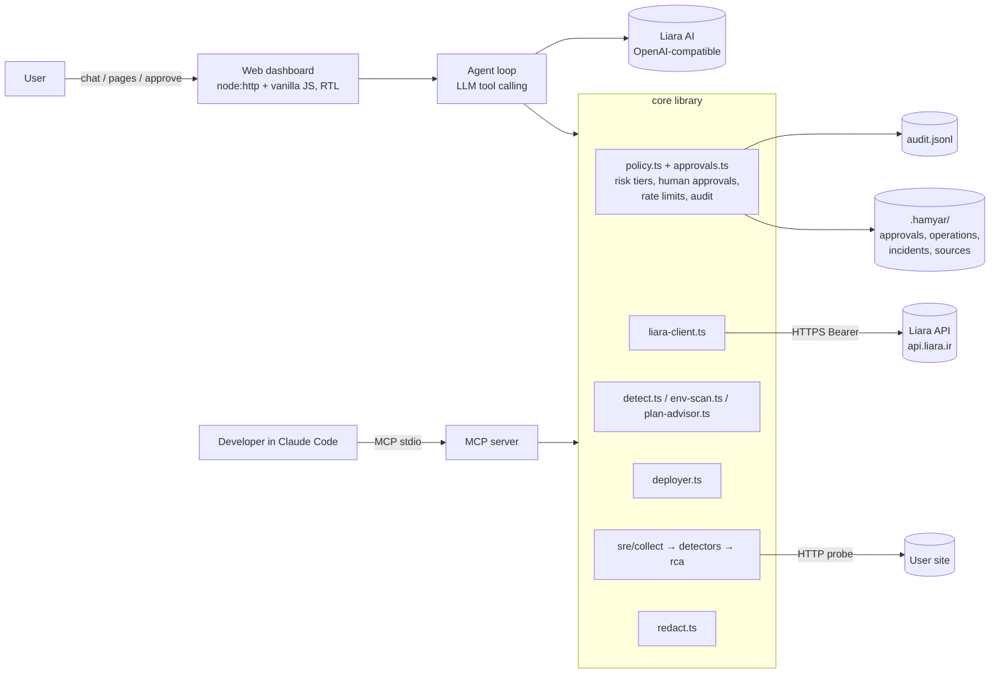
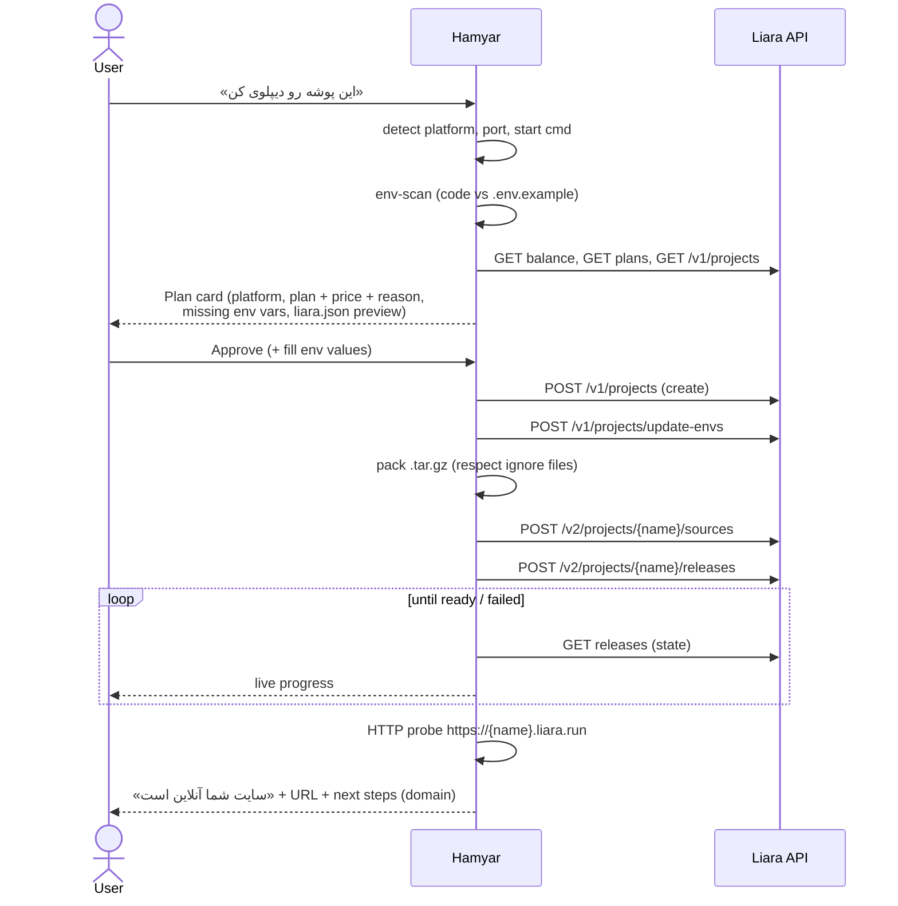

# Hamyar — Technical Design Document

> Hamyar ("همیار", *helper*) is an AI DevOps + SRE assistant for the [Liara](https://liara.ir) PaaS.
> It takes a developer with no DevOps knowledge from "I have code" to "my site is live on my
> domain", and when the site gets slow or starts failing it investigates like a Site Reliability
> Engineer: it collects evidence, ranks root causes, proposes fixes, applies them **only with the
> user's approval**, and verifies the result.

Status: design v1 (written before implementation; sections marked **[verify]** depend on Liara
behaviour that is confirmed in Phase 0 and will be updated).

---

## 1. Goals and non-goals

### Goals
| # | Goal | Judging criterion |
|---|------|-------------------|
| G1 | First deploy in one conversation: detect stack → recommend plan with price → approve → live URL | Liara integration |
| G2 | Release management: new versions, env vars, restart, plan resize, rollback, domains + SSL | Liara integration |
| G3 | On-demand SRE investigation: logs + events + metrics + release history → ranked, evidence-backed root causes | Intelligence / RCA |
| G4 | Fix → verify → auto-rollback loop with before/after numbers | Intelligence / RCA |
| G5 | Human-in-the-loop by risk tier, enforced in code; every action visible and audited | Safety / UX |
| G6 | Persian-first UX; plain-language explanations; clear status of every operation | UX |
| G7 | Honest disclosure of what the Liara API cannot do | Safety / limits |

### Non-goals (v1)
- 24/7 monitoring service (the challenge explicitly does not require it). We provide a *watch mode*
  that probes while the dashboard is open, plus on-demand diagnosis.
- Deleting resources (apps, disks, databases, domains). Never exposed to the agent.
- Handling the user's payment or charging the Liara account.
- Kubernetes / VM (IaaS) management.

---

## 2. User personas and entry points

| Persona | Entry point | Typical request |
|---------|-------------|-----------------|
| Developer who just finished an app | Web dashboard chat (Persian, RTL) | «این پروژه رو روی لیارا بالا بیار» |
| Developer using an AI coding tool | MCP server inside Claude Code / Cursor | "my site returns 500, find and fix it" |
| Site owner | Web dashboard status panel + watch mode | sees a red status → clicks «بررسی کن» |

Both entry points share **one core library**, so behaviour, safety rules and audit log are identical.

---

## 3. Architecture



### 3.1 Repository layout
```
hamyar/
  core/
    liara-client.ts     Typed wrapper around Liara REST and Liara DNS
    detect.ts           Platform detection (port of Liara CLI) + port / start command guess
    env-scan.ts         Env vars the code reads vs .env.example vs Liara envs
    plan-advisor.ts     Recommend a plan with reason and price
    analyze.ts          Launch plan; liara.json with Liara's documented healthCheck
    pack.ts             tar.gz of the project (.gitignore/.liaraignore, never .env)
    deployer.ts         Upload → release → follow build → verify (VERIFIED_HEALTHY / HEALTH_FAILED)
    actions.ts          Change actions with previews; runAction() is the approval gate
    policy.ts           Risk tiers, rate limits, audit log; owns the stores below
    approvals.ts        Persistent approval requests decided only through trusted human channels
    operations.ts       Persisted operations, resume after restart
    incidents.ts        Incident history: opened by diagnose, closed by verify; Persian report
    sources.ts          Deploy sources: ZIP upload, public GitHub archive, local folder (safe extraction)
    wizard.ts           Guided first deploy: analysis, plan options, approval with typed env values
    monitor.ts          Shapes logs / metrics / releases for app pages; approval-gated page actions
    domain-assistant.ts Domain state (Liara, Liara DNS, public DNS) as ordered steps
    domain.ts           DNS records, registrar hints, public DNS checks
    agent.ts            LLM tool-calling loop (OpenAI-compatible), values card for secrets
    ops.ts              Read-only operations shared by MCP and dashboard
    redact.ts           Mask secrets before any LLM call or MCP output
    sre/
      collect.ts        One "snapshot" of everything about an app
      detectors.ts      Deterministic checks → findings with evidence
      rca.ts            Hypothesis board + confidence + fix options
      verify.ts         Success criteria, before/after measurement
      postmortem.ts     Persian incident report (chat/MCP)
  mcp/server.ts         MCP stdio server exposing core as tools
  web/
    server.ts           Static UI + JSON API + streamed agent runs (node:http)
    security.ts         Sessions, login limiter, CSRF guard, CSP and headers
    public/             app.js (shell, chat, status) · wizard.js · apps.js · incidents.js · domains.js
  scripts/              smoke, analyze, diagnose, scenarios, MCP e2e, approve, screenshots
  demo-app/             "Broken Shop" with fault flags for the demo
  docs/                 TECHNICAL.md · UX-SPEC.md · wireframes.html · DEMO.md · screenshots/
  README.md             Quick start (deliverable)
```

### 3.2 Technology choices
| Concern | Choice | Why |
|---------|--------|-----|
| Language | TypeScript, Node ≥ 20 | Same language as Liara's own CLI → detection logic ports 1:1 |
| LLM | Any OpenAI-compatible chat completions with tool calling: Liara AI, or e.g. boxapi.ir | Liara AI's free workspace is rejected by the API (§7.5) |
| Agent loop | Own loop in `core/agent.ts` (no SDK) | Small, testable; approvals and secret values handled in code, not by the model |
| MCP | `@modelcontextprotocol/sdk` (stdio) | Works in Claude Code, Cursor, Claude Desktop |
| Web | `node:http` + vanilla JS (no build step), Vazirmatn self-hosted, RTL, strict CSP | Deploys on Liara as a plain `node` app; nothing to bundle |
| Packing | `tar` + `ignore` (honours `.gitignore` / `.liaraignore`) | Same artefact format the Liara CLI uploads |
| ZIP intake | `yauzl` (reader); `yazl` only in tests | Node has no ZIP reader; entries are validated before writing |
| Tests | Vitest | Fast unit tests for pure logic, plus static checks on the dashboard client |

---

## 4. Liara integration

### 4.1 Authentication
- `Authorization: Bearer <LIARA_API_TOKEN>`; token created by the user in *Console → API*.
- Team accounts: `teamID` query parameter on every call (`LIARA_TEAM_ID`, optional).
- Liara AI uses its own key (`LIARA_AI_API_KEY`) and base URL (`LIARA_AI_BASE_URL`).
- Secrets live only in a local `.env` (dev) or Liara env vars (when the dashboard itself is
  deployed on Liara). They are never sent to the LLM, never printed, never written to the audit log.

### 4.2 Endpoints used
Base URL `https://api.liara.ir` (from the official OpenAPI spec, `developers.liara.ir/spec/paas.yaml`).

| Capability | Method & path | Used by | Tier |
|-----------|---------------|---------|------|
| List apps | `GET /v1/projects` | status, launch (name clash) | T0 |
| App details (status, envs, plan, price, node) | `GET /v1/projects/{name}` | everything | T0 |
| Create app | `POST /v1/projects` `{name, planID, platform, network?}` | launch | T2 |
| Upload source | `POST /v2/projects/{name}/sources` multipart `.tar.gz` → `sourceID` | deploy | T2 (part of deploy) |
| Create release | `POST /v2/projects/{name}/releases` `{sourceID, port, type}` → `releaseID` | deploy | T2 |
| Release history | `GET /v1/projects/{name}/releases?page&count` | deploy polling, RCA, rollback | T0 |
| Restart | `POST /v1/projects/{name}/actions/restart` | fix | T1 |
| Turn on / off | `POST /v1/projects/{name}/actions/scale` `{scale: 0|1}` | fix (turn on only) | T1 on / T2 off |
| Change plan | `POST /v1/projects/{name}/resize` `{planID}` | fix (RAM/CPU) | T2 |
| Env vars (replace whole set) | `POST /v1/projects/update-envs` `{project, variables[]}` | fix, launch | T2 |
| Zero-downtime | `POST /v1/projects/{id}/zero-downtime/{enable|disable}` | launch hardening | T1 |
| Runtime logs | `GET /v1/projects/{name}/logs?since=` | RCA | T0 |
| Events (crash, OOM, deploy) | `GET /v1/projects/{name}/events?start&end` | RCA | T0 |
| Applets (container state + reason) | `GET /v1/projects/{name}/applets` | RCA | T0 |
| Metrics summary | `GET /v1/projects/{name}/metrics/summary` | status, RCA | T0 |
| CPU / RAM / network series | `GET /v1/projects/{name}/metrics/{cpu|memory|network-receive|network-transmit}?since=` | RCA, verify | T0 |
| Disks | `GET /v1/projects/{id}/disks` | RCA (disk full) | T0 |
| Domains list / add | `GET /v1/domains?project=`, `POST /v1/domains` `{name, project, type}` | domain flow | T0 / T2 |
| Domain check (CNAME, status) | `GET /v1/domains/{id}/check` | domain flow | T0 |
| SSL | `POST /v1/domains/provision-ssl-certs` `{domain}` | domain flow | T1 |
| Exec in container | `wss://api.liara.ir?token&cmd&project_id` | RCA (`ps`, `free`, `df -h`) — read-only command allow-list | T0 |
| DB metrics / read-only query | DBaaS reports; Database Inspector `/v1/databases/{id}/queries` | RCA (slow queries) | T0, `SELECT`/`EXPLAIN` only |
| Balance | `GET /v1/billing` | launch pre-check | T0 |
| Account / subscription / Git integrations | `GET /v1/me`, `/v1/me/subscription`, `/v1/me/git-integrations` | onboarding | T0 |
| Plans catalog (prices, specs) | `GET /v1/me` → `plans.projects` (official, `spec/me.yaml`; verified: 42 plans, each with `available`, `region`, `RAM.amount`, `CPU.amount`, `price` = hourly, `displayPrice` = monthly toman on g2 plans). `GET /v1/plans` returns 404. | plan advisor | T0 |
| Rollback **[verify]** | `POST /v2/projects/{name}/releases/{id}/rollback` (community, not in official spec) | rollback | T2 |
| Build logs **[verify]** | not documented | deploy progress | — |

**Fallbacks if a [verify] endpoint does not exist**
- Rollback: re-release a previous release's source if `sourceAvailable` is true; otherwise ask the
  user to redeploy the last good commit. Disclosed as a limit.
- Build logs: poll release `state` and show phase changes; on failure, show the release status and
  tell the user where the full build log is in the console.

### 4.3 Client behaviour
- Timeout 20 s per request, 2 retries with back-off **only for GET** (writes are never retried
  blindly; after an uncertain write the agent re-reads state first).
- Every response normalised to `{ok, status, data, error}`; Liara errors mapped to Persian
  explanations (401 → token expired, 404 → app name wrong, 409 → name taken, 402/400 balance → charge account).
- Log/metric payloads are trimmed server-side before reaching the LLM (see §6.5).

---

## 5. Deployment flow (G1, G2)



### 5.1 Detection (`detect.ts`)
Ported from Liara CLI `src/utils/detect-platform.ts`, same order:
.NET → `composer.json` (laravel / php) → `index.php` → `pyproject.toml` → `requirements.txt` /
`Pipfile` (django / flask / python) → `package.json` (next / angular / vue / react / node) →
`wp-content` (wordpress) → `go.mod` → `Dockerfile` (docker) → static.

Hamyar adds, per platform: default port, start command (`package.json#scripts.start`,
`Procfile`, `manage.py`), runtime version (`engines.node`, `python_requires`), and a list of
**reasons** ("package.json depends on `next` → platform next") shown to the user.

### 5.2 Env scan (`env-scan.ts`)
Regexes over source files (skipping `node_modules`, `.git`, build output):
`process.env.X`, `process.env['X']`, `import.meta.env.X`, `os.environ['X']`, `os.getenv('X')`,
`env('X')` (Laravel), `config('…')` hints, `os.Getenv("X")`.
Result: `required` (read by code, not in `.env.example` defaults), `documented`
(in `.env.example`), `setOnLiara` (current app envs, **names only**). Missing ones become form
fields on the plan card; values are typed by the user and never passed to the LLM.

### 5.3 Plan advisor (`plan-advisor.ts`)
Rule-based, explainable:
- static / SPA → smallest plan
- node / python / php small → small plan; next / laravel / django → one step up (build + SSR memory)
- heavy deps (puppeteer, tensorflow, sharp, celery) → bump RAM
- existing app with memory p95 > 80 % of plan → recommend next plan (used by RCA too)
Output: `{planID, monthly, hourly, reason[], alternatives[]}`.

### 5.4 `liara.json` generation
Always includes `platform`, `port`, `app`, and a `healthCheck` block (HTTP probe of `/` or a
detected `/health` route) so Liara's zero-downtime deploy keeps the old release serving when a new
one is unhealthy. Shown to the user before writing it into the project.

### 5.5 Post-deploy verification and auto-rollback
1. Wait until release state is ready **[verify state names]**.
2. Probe the URL 5× → success if ≥ 4 responses are 2xx/3xx and p95 < 2 s.
3. On failure → collect snapshot → if the previous release was healthy, *propose* rollback
   (T2 approval). In "auto-rollback" mode the user pre-approved this once for the session.

---

## 6. SRE engine (G3, G4)

### 6.1 Pipeline
```
trigger ─► collect snapshot ─► deterministic detectors ─► hypothesis board ─► fix options
   ▲                                                                              │
   │                         verify (before/after) ◄── apply (after approval) ◄───┘
   └──────────── auto-rollback / next hypothesis if verify fails
```
Triggers: user message («سایتم کند شده»), dashboard watch-mode probe failure, failed deploy
verification, MCP `diagnose` call.

### 6.2 Snapshot (`collect.ts`)
Collected in parallel with a fixed time window (default: last 30 min, or since the last release
if more recent):
- app details (status, plan, envs **names only**, scale)
- release history (last 5) with timestamps
- runtime logs (window), events, applets (state + reason)
- metrics: CPU, memory series; summary (incl. disk usage)
- HTTP probe of the site: status codes, latency p50/p95 over N requests, specific paths if given
- optional exec (allow-listed read-only commands): `free -m`, `df -h`, `ps aux --sort=-%mem | head`
- optional DB: CPU/memory of linked database, read-only diagnostic query

Every item gets an **evidence id** (`E1`, `E2`, …) so later claims can cite it.

### 6.3 Deterministic detectors (`detectors.ts`)
Pure functions `snapshot → Finding[]`, unit-tested with fixtures. A finding =
`{id, kind, severity, summary_fa, evidence: [E..], startedAt}`.

| Detector | Signal | Typical fix |
|----------|--------|-------------|
| `missing-env` | `KeyError`, `undefined`, `is not set`, `ECONNREFUSED 127.0.0.1` + env-scan diff | set env var (T2) |
| `crash-loop` | applets restarting / events with exit codes | depends on log cause |
| `oom` | event/reason OOMKilled or memory ≥ 95 % of plan before restart | restart now (T1) + resize (T2) or fix leak |
| `memory-leak` | monotonic memory growth slope across window, resets on restart | code fix + temporary resize |
| `cpu-saturated` | CPU at plan limit for > 5 min while latency high | resize (T2) / optimise hot path |
| `bad-release` | error rate rises within 10 min after `currentRelease` changed; previous release clean | rollback (T2) |
| `slow-endpoint` | probe p95 high on a path; timeout logs; repeated identical SQL lines (N+1) | code fix (coding agent), DB index |
| `port-mismatch` | log "listening on 3000" while release port 8080; probe 502 | redeploy with correct port |
| `blocked-registry` | build/install 403 / ETIMEDOUT from npm, PyPI, Docker Hub | `build.location: germany` or mirror |
| `disk-full` | disk usage ≥ 90 % / `ENOSPC` | resize disk (T2) / clean up |
| `db-down` | `ECONNREFUSED`/`timeout` to DB host, DB events | check DB status, credentials env |
| `http-5xx-generic` | probe 5xx with stack traces | cluster stack traces → coding agent |

**Causality rule:** a finding whose `startedAt` is after the incident onset is treated as a
symptom, not a root cause.

### 6.4 Hypothesis board (`rca.ts`)
- Each finding family becomes a hypothesis with status **validated / invalidated / inconclusive**.
- Confidence is computed from evidence (count and strength of supporting vs contradicting items),
  not from the LLM's self-assessment.
- Rejected hypotheses are shown too («رد شد: مصرف CPU عادی است، E7»), which makes the reasoning
  auditable.
- The LLM receives the board (not raw logs) and writes the Persian explanation, ranks fix options
  and fills in code-level suggestions; it must cite evidence ids for every claim.
- Each fix option: `{action, tier, expectedEffect, risk, downtime, cost, rollbackPath}`.

### 6.5 Context budget and redaction
- Logs are clustered by normalised message template (numbers/ids/uuids stripped); the LLM gets
  top-N templates with counts, first/last seen, and 2 sample lines each.
- `redact.ts` masks: Liara token, any env *value* of the app, emails, IPs, bearer/JWT strings,
  connection strings (`postgres://user:pass@…`) → reversible placeholders.

### 6.6 Verify (`verify.ts`)
Success criteria are defined **before** applying a fix, e.g. "probe 2xx ≥ 95 %, p95 < 800 ms over
2 min, no new OOM events". After the action Hamyar re-measures and shows a before/after table.
If criteria fail: offer rollback of the change (or of the release) and move to the next hypothesis.

### 6.7 Postmortem (`postmortem.ts`)
Persian markdown report: summary, timeline, root cause with evidence, actions taken (who approved,
when), verification numbers, prevention suggestions. Downloadable and stored with the audit log.

---

## 7. Human-in-the-loop and safety (G5, G7)

### 7.1 Risk tiers
| Tier | Meaning | Examples | Behaviour |
|------|---------|----------|-----------|
| T0 | Read-only | status, logs, metrics, releases, plans, balance, domain check, diagnose, allow-listed exec | Runs automatically |
| T1 | Low-risk, reversible | restart, turn app on, enable zero-downtime, enable SSL | Approval card, one click |
| T2 | Changes state / costs money | create app, deploy, env update, resize plan, rollback, add domain, turn app off | Preview card (diff, price delta, expected downtime, rollback path) + explicit approve |
| T3 | Destructive | delete app / disk / database / domain, data writes in DB | **Not implemented as tools.** Agent explains how to do it in the console |

Enforcement is in code (`core/actions.ts` → `runAction()`, `core/approvals.ts`), not in prompts.
A tool of tier ≥ T1 first files an **approval request** in a persistent store shared by the MCP
server, the dashboard and the terminal (`.hamyar/approvals.json`). It executes only when:
- a human decided it through a **trusted channel**: the authenticated dashboard, an MCP elicitation
  answer, or `npm run approve -- <id>` in an interactive terminal (refused without a TTY, so an
  agent's own shell cannot approve);
- the arguments hash to exactly what was approved (salted HMAC over canonical arguments, nested
  values included);
- it was not used before, rejected, revoked or older than 10 minutes.

The request id is not a credential: a model that calls back with it before a human approved gets
"not approved yet" and nothing runs. Secret argument values are never written to the store.

### 7.2 Approval card contents
Action in plain Persian · exact arguments · diff (env before/after with values masked, plan
before/after with price) · expected downtime · cost impact · how to undo · buttons
**تأیید / ویرایش / رد (با دلیل)**. A rejection reason is returned to the agent so it adapts.

### 7.3 Autonomy modes (session setting)
- **فقط مشاهده (Observe)**: T0 only.
- **بازبینی (Review, default)**: T0 auto; T1/T2 need approval.
- **خودکار محدود (Auto-safe)**: T0 + T1 auto (restart, SSL); T2 still needs approval.

### 7.4 Guard rails
- Rate limits, counted from the shared audit log so MCP and dashboard share one budget: max 3
  deploys / 10 min, max 10 write actions / hour, restart at most once per 5 min per app.
- No blind retry of writes; after an ambiguous result the state is re-read.
- Kill switch: «توقف» revokes every pending and approved-but-unused request.
- After a dashboard restart, dashboard-filed requests (whose agent run died with the process) are
  revoked with a reason; MCP-filed ones stay.
- Audit log (`audit.jsonl`): timestamp, tool, tier, args (secrets masked), approval id, who approved
  and through which channel, outcome (previewed / approved / executed / failed / rejected / blocked / revoked).
- Operations (`.hamyar/operations.json`): every executed change and its state transitions, so the
  dashboard shows them after a refresh and an in-flight deploy with a release id is followed to the
  end and verified after a restart; anything else is marked INTERRUPTED with an explanation.

### 7.4.1 Dashboard security (`web/security.ts`)
- No password → listens on 127.0.0.1 only. With `HAMYAR_DASHBOARD_PASSWORD` (12+ characters, else
  the server refuses to start) → HttpOnly, SameSite=Strict, Secure session cookie; sessions expire
  after 1 h idle / 8 h total; `POST /api/logout`.
- Login brute force: 5 failures per address per 15 minutes, then HTTP 429.
- CSRF: every state-changing request must be same-origin (Origin check) and `application/json`.
- Headers on every response: strict CSP (`default-src 'self'`, no third-party origins, font
  self-hosted), `X-Frame-Options: DENY`, `nosniff`, `no-referrer`.
- `web/public/dev-sim.js` is served only with `HAMYAR_DEV=1`.
- Model input is redacted: JWTs, provider keys (`sk-`, `box-ai-`, `ghp_`, AWS, Slack), `key=value`
  secrets, passwords in URLs, emails, IPs, and the selected app's own env values. MCP tool output is
  redacted the same way.

### 7.4.2 Deployment states and verification (`core/deployer.ts`)
`PREPARING → UPLOADING → BUILDING → DEPLOYING → VERIFYING → VERIFIED_HEALTHY | HEALTH_FAILED`, or
`FAILED` / `CANCELED` (`ANALYZING` and `AWAITING_APPROVAL` precede it in the caller). A release
that Liara marks READY becomes VERIFIED_HEALTHY only after three probe rounds pass on the detected
health path and Liara reports the new release as current; otherwise HEALTH_FAILED with the measured
reason. When the project has a health route, the release carries Liara's documented `healthCheck`
(`CMD curl --fail http://localhost:<port><path> || exit 1`, the docs' example timings), so Liara keeps
the previous release serving until it passes (`HAMYAR_HEALTHCHECK=off` disables it). A first deploy
sets the required env vars before releasing; if anything fails after the app was created, the user
is told the app exists and is billed.

### 7.4.3 Rollback (`rollback` action)
Validates the target against the last 20 releases (exists, READY, not current), then tries Liara's
rollback endpoint (not in the official spec). Only if that endpoint answers 404/405 does it republish
the target release's stored source through the official releases endpoint, when the release exposes
a source id. Either way the result is verified like a deploy. If neither path is possible, the user
is told to redeploy the last good code from the project folder. **Unverified on a live app.**

### 7.5 Limits disclosed to the user
Shown on the dashboard settings page («همیار چه کارهایی نمی‌کند») and in the README:
- Rollback and build logs use endpoints the Liara CLI uses but the official spec does not document;
  rollback falls back to republishing the target release's source (§7.4.3). Not yet run on a live app.
- Liara exposes no request counts or status-code distribution; the monitoring page says so instead
  of drawing them. The unit of network metrics is shown as returned and is not yet confirmed.
- Deploy from GitHub supports public repositories only (Hamyar downloads the archive; Liara has no
  documented deploy-from-GitHub API). ZIP uploads are capped at 50 MB (300 MB unpacked).
- Liara AI: the docs mention one free `base` workspace per user, but `POST ai.liara.ir/v1/workspaces`
  rejects it (`"plan" must be one of [standard, pro]`, checked 2026-10-21). The AI agent therefore
  needs a charged account; the quick-action buttons (diagnose, status, logs) work without it.
- Metrics resolution and log retention are whatever Liara returns; no request tracing, so latency
  root causes inside code are hypotheses, not proofs.
- Hamyar cannot charge the account, buy a domain, or change records at the domain registrar
  (IRNIC etc.) — it tells the user exactly what to enter and then verifies.
- Watch mode works only while the dashboard is open (no 24/7 monitoring).
- LLM explanations can be wrong; every claim cites evidence so the user can check.

---

## 8. Domain flow (`core/domain.ts`, `check_domain`, `use_liara_dns`, `create_dns_records`)
Liara asks for an ALIAS/CNAME record (traffic), a TXT record (ownership) and an `_acme-challenge`
CNAME (SSL) per domain (docs: `paas/domains/add-domain`). `.ir` domains are managed at IRNIC (nic.ir).

1. `add_domain` (T2) → `POST /v1/domains`.
2. `check_domain` reads `GET /v1/domains/{id}/check` (`CNameRecord`, `verificationCode`), the Liara DNS
   zone if any (`dns-service.liara.ir/api/v1/zones/{zone}`), and **public DNS** through 1.1.1.1 / 8.8.8.8
   (`node:dns`), then says exactly what is missing and which tool comes next.
3. Two paths:
   - **Liara DNS (recommended for `.ir`)**: `use_liara_dns` (T2) creates the zone and returns the two
     nameservers; the user sets them in the IRNIC panel (Hamyar cannot log into registrars);
     `check_domain` detects when public NS match; `create_dns_records` (T2) creates the app records via
     `POST /api/v1/zones/{zone}/dns-records`.
   - **Own DNS (Cloudflare, ArvanCloud…)**: `check_domain` lists each record with ✅/⏳ visibility on public
     DNS and what is currently there, plus the apex-CNAME caveat (use ALIAS/ANAME).
4. When records are visible → `enable_ssl` (T1).

The dashboard's domain assistant (`core/domain-assistant.ts`) turns the same reads into ordered steps
with a state each — `done`, `current` (Hamyar can do it, after approval), `manual` (the user must act
at the registrar) or `todo`. A manual step is never reported done until public DNS shows it.

Verified read-only against real services: Liara DNS accepts the console token (`GET /api/v1/zones`),
public lookups work (e.g. NS of `liara.ir`). **[verify]** with a real domain: the exact `contents` shape
per record type (`{host}` for CNAME/ALIAS, `{text}` for TXT is assumed — not documented), the TXT
record name, and the `_acme-challenge` record (not returned by the documented check endpoint, so it is
shown from the Liara console until confirmed).

---

## 9. Interfaces

### 9.1 Web dashboard (`web/server.ts`, `web/public/`)
Plain `node:http` server + vanilla JS (no build step), light design from `docs/UX-SPEC.md`:
side menu (right), page in the centre, service status panel (left); below 1200 px the menu shrinks
to icons and the status panel becomes a sheet; below 768 px a bottom tab bar replaces the menu.
Hash routes, one file per area:

| Route | File | Screen |
|---|---|---|
| `#/` | `app.js` | A · command center: four actions, chat with run cards, hypothesis board, approval cards |
| `#/deploy` | `wizard.js` | B · source (ZIP / GitHub / local) → analysis and real plans → name and env values → approval → progress → verified result |
| `#/apps`, `#/apps/:app/:tab` | `apps.js` | services list; app overview, C · monitoring, logs, releases; restart / on-off / rollback |
| `#/domains/:app/:domain` | `domains.js` | F · domain assistant |
| `#/incidents`, `#/incidents/:id` | `incidents.js` | G · history and D · incident workspace |
| `#/approvals`, `#/settings` | `app.js` | E · approvals inbox (dashboard + Claude Code), read-only settings, kill switch |

The agent loop (`core/agent.ts`) runs the model with tool calling; read-only tools run directly,
change tools pause and stream an approval card; the run resumes when the user decides
(`POST /api/approve`). For `set_env` / `launch_app` the model only names the keys; the user types
values into password fields and they go straight to Liara. Page buttons (restart, on/off, rollback,
domain steps) call `POST /api/action/request`, which files a request marked `direct`; approving it
in the dashboard runs it on the server and the page follows it through `/api/operations`.
`POST /api/stop` revokes every pending and approved-but-unused request.

API used by the pages (all behind the session and CSRF checks of §7.4.1):

| Endpoint | Purpose |
|---|---|
| `GET /api/config`, `GET /api/me` | mode, AI provider, auth; account name, e-mail, balance |
| `GET /api/apps`, `GET /api/status?app=`, `GET /api/probe?app=` | apps; status panel; live probe |
| `GET /api/apps/:app/{metrics,logs,releases,domains,domain}` | app pages and domain status |
| `POST /api/source/{zip,github,local}`, `POST /api/wizard/{analyze,request,start,cancel}` | deploy wizard (`start` streams NDJSON progress) |
| `POST /api/action/request`, `GET/POST /api/approvals`, `POST /api/approve`, `GET /api/operations` | approvals and operations |
| `GET /api/incidents`, `GET /api/incidents/:id`, `POST /api/incidents/:id/close` | incidents (actions merged from the audit log) |
| `POST /api/chat`, `POST /api/quick`, `POST /api/stop` | agent run, read-only quick tools, kill switch |

Data honesty in the UI: every number names its source («بررسی همیار» or «لیارا»); a series Liara does
not return is shown as unavailable with the reason; success is shown only after verification.
RTL, Vazirmatn, Persian digits with proportional figures, Latin runs isolated with `<bdi>`, no inline
styles (the CSP forbids them; widths are applied through the CSSOM). Screenshots: `docs/screenshots/`
(`npx tsx scripts/screenshots.ts` regenerates them; names ending in `-sample` use sample responses
injected in the browser because the account has no app yet).

### 9.2 MCP tools (`mcp/server.ts`, 21 tools)
| Tool | Tier | Purpose |
|------|------|---------|
| `liara_overview` | T0 | balance, apps with status, safety mode, latest audit entries |
| `analyze_project` | T0 | detect + env-scan + plan recommendation + balance + `liara.json` for a local folder |
| `app_status` | T0 | details, current release, env names, live probe |
| `get_logs` | T0 | clustered logs for a window, errors first |
| `diagnose` | T0 | full SRE pipeline → hypothesis board + ranked fixes + next tool to call + code-fix brief |
| `verify` | T0 | re-measure against targets fixed before the change; before/after table |
| `check_domain` | T0 | domain status + exact DNS record to set at the registrar |
| `incident_report` | T0 | Persian postmortem from the last diagnose + audited actions |
| `audit_log` | T0 | latest previewed / executed / failed / rejected / blocked actions |
| `launch_app` | T2 | create app on a plan + first deploy |
| `deploy` | T2 | pack (no `.env`) → upload → release → follow build → probe |
| `set_env` | T2 | merge with current env, diff preview without values; values can come from a local file |
| `resize_plan` | T2 | preview with monthly price difference |
| `rollback` | T2 | preview target release |
| `turn_off_app` | T2 | site goes offline (marked destructive) |
| `add_domain` | T2 | then `check_domain` |
| `use_liara_dns` | T2 | create the zone in Liara DNS, return nameservers for the registrar |
| `create_dns_records` | T2 | create the app's records in Liara DNS once nameservers are active |
| `restart_app`, `turn_on_app`, `enable_ssl` | T1 | low-risk, reversible |

Tools carry MCP annotations (`readOnlyHint`, `destructiveHint`) for the client UI, but safety does
not depend on them: approval is enforced server-side in `core/actions.ts` → `runAction()`.

**Approval flow in MCP**
1. If the client supports MCP *elicitation*, the server shows the preview **to the human** and asks
   «اجرا شود؟» with an optional rejection reason. The model cannot answer this form. A rejection is
   audited and the reason is returned to the model so it can propose something else.
2. Otherwise the first call files an approval request and returns its id with the instruction to
   approve it in the dashboard or with `npm run approve -- <id>`. The model never receives
   anything that authorizes execution; calling back with the id before a human approved returns
   "not approved yet".

Verified end to end with a real MCP client (`npm run mcp-smoke`): request filed → model calls back
unapproved, nothing runs → human approves → different args blocked → same args executed → reuse
blocked → elicitation "no" recorded with reason → elicitation "yes" executed.

**Connecting**: `hamyar/.mcp.json` registers the server for Claude Code when the `hamyar` folder is
opened; any MCP client can run `npx tsx mcp/server.ts` from the `hamyar` folder.

### 9.3 Coding-agent handoff (MCP)
`diagnose` returns, when the cause is in code, a **fix brief**: error, stack frame (file:line),
evidence ids, suggested change. Claude Code edits the local code, then calls `deploy`
(approval), then `verify`. This closes the loop "SRE finds → coding agent fixes → SRE verifies".

---

## 10. Demo application ("Broken Shop")
Express app deployed on Liara with fault flags (env `FAULT`):

| Flag | Behaviour | Expected Hamyar result |
|------|-----------|------------------------|
| *(none)* | healthy shop | baseline |
| `missing_env` | reads `DATABASE_URL`, throws → 500 | `missing-env`, set env, verify 200 |
| `memory_leak` | grows an array per request | `memory-leak`/`oom`, restart + resize or code fix |
| `slow` | N+1 style repeated "queries" + sleeps on `/products` | `slow-endpoint`, code fix via coding agent, p95 before/after |
| `bad_release` | new release throws on `/` | `bad-release`, rollback, verify |

A load script generates traffic so metrics move during the demo.

---

## 11. Testing and quality
- Unit tests (Vitest, 238 at the end of Phase 3) for pure logic: detection, env scan, plan
  advisor, packing, deploy state machine, detectors, RCA, verify, postmortem, approvals, policy,
  actions, operations, sources (ZIP traversal / links / size limits, GitHub download), wizard,
  monitor shaping and page actions, incidents, domain assistant, dashboard security, redaction.
- `web/ui.test.ts`: every element the client scripts look up exists, no inline styles, every
  script is loaded (added after a missing element stopped `app.js` at load).
- `npm run mcp-smoke`: MCP end to end with a real client (§9.2).
- Live scenario runs against a real Liara account for each demo flag, recorded in the README
  scorecard (scenario → correct root cause → time to fix) — pending a charged account.
- UI checked in a browser at 1440, 900 and 375 px (no horizontal overflow, no wrapped buttons,
  44 px controls) and captured in `docs/screenshots/`.

---

## 12. Configuration
| Variable | Required | Description |
|----------|----------|-------------|
| `LIARA_API_TOKEN` | yes | Liara console API key |
| `LIARA_TEAM_ID` | no | team mode |
| `LIARA_API_BASE` | no | default `https://api.liara.ir` |
| `LIARA_AI_API_KEY` | yes (web) | Liara AI key |
| `LIARA_AI_BASE_URL` | yes (web) | Liara AI OpenAI-compatible base URL: `https://ai.liara.ir/api/{workspaceID}/v1` |
| `LIARA_AI_WORKSPACE_ID` | alt. | instead of an AI key: use the console token on `/api/v1/{workspaceID}/playground/chat/completions` (verified: the console token is accepted by `ai.liara.ir/v1/workspaces`) |
| `LIARA_AI_MODEL` | no | model id used by the agent |
| `HAMYAR_MODE` | no | `observe` / `review` (default) / `auto-safe` |
| `HAMYAR_DASHBOARD_PASSWORD` | on a server | without it the dashboard binds to 127.0.0.1 only; with it every API call needs a session cookie |

---

## 13. Delivery plan
| Phase | Hours | Output |
|-------|-------|--------|
| P0 Setup & API smoke test | 3 | `.env`, smoke script, [verify] items resolved |
| P1 Core + deploy | 10 | client, detect, env-scan, plan advisor, deployer; demo-app deployed |
| P2 SRE engine | 10 | collect, detectors, rca, verify, postmortem |
| P3 MCP server | 5 | tools + tiers, tested in Claude Code |
| P4 Web dashboard | 12 | chat, approval cards, status, timeline; deployed on Liara |
| P5 Domain flow | 3 | add/check/SSL with Persian instructions |
| P6 README + GitHub | 4 | deliverable docs |
| P7 Demo + video script | 6 | rehearsed scenarios, 5-min script |
| Buffer | 3 | |

Cut order if late: DB-inspector checks → WebSocket exec → SSL automation.
