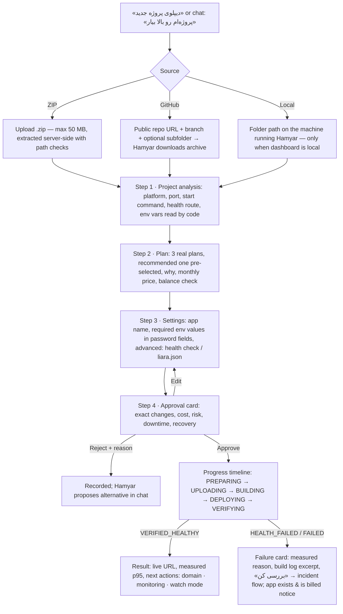

# Hamyar — UX architecture and design system (Phase 2)

Status: proposal for approval. Nothing here is implemented yet; Phase 3 builds it.
Wireframes: [`docs/wireframes.html`](wireframes.html) (open in a browser; desktop and 375 px).

## 0. Decisions that shape everything

| Decision | Choice | Why |
|---|---|---|
| Visual direction | **Light** layout from the user's first reference image (white/lavender surfaces, cobalt primary, small robot mascot) | The user chose it explicitly on 2026-10-21, after the brief's "dark navy" suggestion. Dark mode is not planned. |
| Brand | **Hamyar**, not Liara. "Liara" appears only as the platform name ("روی لیارا") | The reference shows the Liara logo; a third-party tool must not look like Liara's own console. |
| Layout | Desktop: side menu (right) · chat + operations (centre) · service status panel (left) | User's instruction. |
| Core pattern | **Conversation + contextual action cards** | Brief's core requirement: the chat coordinates; every operation shows up as a structured card, not a long message. |
| Deploy entry | «دیپلوی پروژه جدید» → choose **ZIP upload**, **GitHub**, or **local project** → stepwise wizard | User's instruction. |
| Data honesty | Every number on screen comes from Liara's API or Hamyar's own probe, labelled with its source. Anything Liara does not expose is shown as «در دسترس نیست», never drawn. | Brief: no fabricated metrics; judges score reliability. |
| Stack | Keep the vanilla JS + `node:http` dashboard; split `app.js` into ES modules, hash router | No framework migration two days before the deadline; CSP `'self'` already allows modules. |

### What the reference image shows that Hamyar must change

| In the image | Problem | Hamyar does instead |
|---|---|---|
| Liara logo, "Ali Rezaei" avatar | Impersonation / fake person | Hamyar logo; real account name and e-mail from `GET /v1/me` |
| Plan cards "Starter / Pro / Scale" with made-up prices | Liara plans have different names and live prices | Three real plans from the live catalogue: the cheapest that fits, the recommended one, one bigger — real monthly price from `displayPrice` |
| "Traffic (24h)" chart in requests | Liara gives network **bytes**, not request counts | Network in/out chart from `metrics/network-receive|transmit`, labelled in KB/s |
| "Request status" donut 98.7% / 1.1% | No per-request status API | **Health-check results** card: Hamyar's own probe rounds (success ratio, p95) with time of measurement. Error count from logs only when logs contain status codes, labelled «از روی لاگ‌ها» |
| "Fixed in 1 click" success screen | Must not claim success before verification | Result screen appears only after `VERIFIED_HEALTHY`; otherwise a failure screen with the measured reason |
| Deploy step "Fetching code from GitHub" | Liara has no documented deploy-from-GitHub API | Hamyar downloads the repo archive itself, then uploads through the official sources endpoint — the step says so |

## 1. UX architecture

```
                      ┌──────────── Hamyar dashboard (one page, hash routes) ────────────┐
 Side menu ──────────►│ #/ (Command center)  #/deploy  #/apps/:name/{overview|monitoring|│
                      │  logs|releases|settings}  #/incidents  #/incidents/:id  #/domains │
                      │  #/approvals  #/settings                                          │
                      └───────────────┬───────────────────────────────┬──────────────────┘
                                      │ chat thread (persists across routes)
                                      ▼                               ▼
                  Contextual cards rendered in the thread     Status panel (selected app)
                  (analysis, plan, env form, approval,        health · CPU · RAM · release ·
                   progress, board, verify, DNS)              pending approvals · watch mode
                                      │
                                      ▼
            /api/* (existing) + new: /api/source/*, /api/apps/:name/{metrics,logs,releases},
            /api/incidents, /api/domains — all through core/actions.ts → policy → Liara API
```

Principles:
1. **One conversation, many surfaces.** The chat thread is shared by every route; dedicated pages (wizard, monitoring, incidents) are the same cards laid out in full width. Starting an operation from a page posts a short line in the chat so history stays in one place.
2. **Progressive disclosure.** Beginners see one sentence, one decision, one button. Technical detail (`liara.json`, raw logs, release ids, health-check command) sits behind «جزئیات فنی».
3. **Visible system state.** Every card has explicit states: loading (skeleton), empty, unavailable (with reason), failed (with explanation + next step), success (only when verified).
4. **Every button does something real.** No decorative controls. A control whose backend is not available is not rendered.
5. **Approval is a component, not a message.** Same card in chat, wizard, incident page and approvals inbox; it is bound to the persistent approval store from Phase 1.

## 2. User flows

### 2.1 First deploy (the hero flow)


### 2.2 HTTP 500 / slow site (SRE flow)
```mermaid
flowchart TD
  A[Chat «سایتم ۵۰۰ می‌ده» / watch-mode alert / «تشخیص مشکل» tile] --> B[Incident created: status «در حال بررسی»]
  B --> C[Collect: logs, events, applets, CPU/RAM, releases, live probe — shown as live checklist]
  C --> D[Evidence cards E1..En]
  D --> E[Hypothesis board: confirmed · probable · inconclusive · rejected (with reason)]
  E --> F[Ranked fixes: restart · set env · rollback · plan change · code fix (handoff to coding agent)]
  F --> G[Approval card]
  G -->|Approve| H[Execute → verify: before/after table]
  G -->|Reject| J[Reason recorded on incident timeline → next fix offered]
  H --> K[Incident closed with outcome + Persian report]
```

### 2.3 Domain
Domain field → add on Liara → choose: «دامنه‌ام در ایرنیک است» (nameservers) / «دامنه در سرویس دیگری است» (CNAME/A records) / «فعلاً دامنه نمی‌خواهم» → copyable values with copy buttons → «بررسی اتصال» (public DNS check) → SSL progress. Steps the user must do at the registrar are marked «این مرحله را خودتان انجام دهید».

### 2.4 Approval from MCP (Claude Code)
Request arrives in the approvals inbox with the «درخواست از Claude Code» badge; the side-menu item shows a count; the same approval card is used.

## 3. Page structure

| Route | Screen (brief) | Contents |
|---|---|---|
| `#/` | A · Command center | Greeting with mascot, 4 primary actions (دیپلوی پروژه · وضعیت سرویس · تشخیص مشکل · مدیریت دیپلوی), composer, recent apps, recent operations. Chat thread replaces the greeting once a conversation starts. |
| `#/deploy` | B · Intelligent deployment | 4-step stepper (منبع و بررسی · پلن · تنظیمات · دیپلوی) as in the reference; source chooser first. Survives refresh (wizard state in `sessionStorage`, operation state from `/api/operations`). |
| `#/apps` | Services list | Real apps from `/v1/projects`: name, status, plan, platform; «دیپلوی جدید» button. |
| `#/apps/:name` | App detail | Header (name, status pill, URL, actions: ری‌استارت · روشن/خاموش · rollback — each opens an approval). Tabs: نمای کلی · مانیتورینگ · لاگ‌ها · نسخه‌ها · تنظیمات (env keys, plan). |
| `#/apps/:name/monitoring` | C · Monitoring | Health (probe), CPU, RAM vs plan limit, network in/out, disk usage (summary), release markers on charts. Range: ۱ ساعت · ۲۴ ساعت · ۷ روز (what Liara returns). |
| `#/apps/:name/logs` | Log inspection | Level filter (همه · خطا · هشدار), search, refresh; ERROR/WARN badges; «تحلیل همیار» card under logs when errors exist → opens incident. |
| `#/incidents` | G · Incident history | Chronological list: trigger, root cause, fix, approval outcome, verification, final state. |
| `#/incidents/:id` | D · Incident workspace | Status + severity, timeline, evidence E1.., hypothesis board, relevant logs, code location when found, fixes, approval, before/after, report (copy / download .md). |
| `#/domains` | F · Domain assistant | Per-app domains, flow 2.3. |
| `#/approvals` | E · Approvals inbox | Pending requests (dashboard + MCP), recently decided with who/channel. |
| `#/settings` | Settings | Read-only real config: mode (observe/review/auto-safe), AI provider + model, auth on/off; actions: logout, «توقف همه‌ی عملیات» (kill switch). |

## 4. Component inventory

| Component | Used in | States | Data source |
|---|---|---|---|
| `SideMenu` | all | active route, approvals count badge | `/api/approvals` |
| `TopBar` | all | search (apps), notifications = approvals/alerts, account | `/v1/me`, `/api/approvals` |
| `StatusPanel` | desktop left column / mobile sheet | no app · loading · healthy · degraded · down · off | `/api/status`, `/api/probe` |
| `MetricTile` (Health, Response time, CPU, RAM) | status panel, overview | value · unavailable (reason) · stale (time) | metrics summary, probe |
| `AreaChart` / `Sparkline` | monitoring, tiles | data · empty · unavailable | metrics API |
| `ChatThread`, `Composer`, `QuickActions` | command center | idle · thinking · streaming · stopped · AI off (quick actions only) | `/api/chat`, `/api/quick` |
| `SourceChooser` (ZIP / GitHub / Local) | wizard step 1 | choosing · uploading (progress) · invalid · ready | new `/api/source/*` |
| `AnalysisCard` | wizard, chat | analyzing · done · unsupported platform | `core/analyze.ts` |
| `PlanCards` (3, recommended badge, «تغییر») | wizard, chat | loading · insufficient balance warning | `/v1/me` plans, `/v1/billing` |
| `EnvForm` (password inputs, «از فایل .env») | wizard, chat | missing · filled · skipped (with warning) | `scanEnv`; values sent only to Liara |
| `ApprovalCard` | everywhere | pending · approved · rejected (reason) · expired · revoked · from MCP | approval store |
| `DeployTimeline` | wizard, chat, operations | per step: waiting · running (elapsed) · done · failed | `/api/operations` + events |
| `ResultCard` | wizard, chat | VERIFIED_HEALTHY · HEALTH_FAILED · FAILED · CANCELED | `DeployResult.verification` |
| `EvidenceList` (E1..) | incident, chat | — | `boardSummary` |
| `HypothesisBoard` | incident, chat | confirmed · probable · inconclusive · rejected | `core/sre/rca.ts` |
| `VerifyTable` (before/after) | incident, chat | passed · failed | `verifyText` rows |
| `LogViewer` | logs, incident | loading · empty · error filter | `/logs` |
| `ReleaseList` (+ rollback) | app detail | current · READY · FAILED | `/releases` |
| `DnsRecords` (copy buttons) | domains | pending · verified · SSL pending · SSL on | domain APIs |
| `IncidentRow`, `IncidentTimeline` | incidents | open · resolved · unresolved | new incident store |
| `EmptyState`, `Unavailable`, `ErrorState`, `Skeleton`, `Toast` | all | — | — |

## 5. Design tokens (light)

```css
:root {
  /* surfaces */
  --bg: #f6f7fd;          /* page, faint lavender */
  --surface: #ffffff;     /* cards */
  --surface-2: #f1f3fb;   /* inputs, tabs track, hover */
  --border: #e4e7f2;
  --border-strong: #cfd5e8;
  /* text */
  --text: #161a33;        /* 15.8:1 on white */
  --text-2: #4a5175;      /* 7.6:1 */
  --text-3: #6b7293;      /* 4.9:1 — smallest allowed for body text */
  /* brand */
  --primary: #3d4ee8;     /* cobalt; white text 5.6:1 */
  --primary-hover: #2f3fd6;
  --primary-soft: #eceffe;
  --violet: #8b5cf6;      /* accents only: recommended badge, mascot, AI analysis */
  --violet-soft: #f3eefe;
  /* status */
  --success: #12a150;  --success-soft: #e8f7ee;   /* verified only */
  --warning: #c27803;  --warning-soft: #fdf4e3;
  --danger:  #dc2f45;  --danger-soft:  #fdecee;
  --info:    #2f80ed;  --info-soft:    #eaf2fe;
  /* shape & depth */
  --radius-sm: 8px; --radius: 12px; --radius-lg: 16px; --radius-xl: 20px;
  --shadow-1: 0 1px 2px rgba(22,26,51,.04), 0 1px 3px rgba(22,26,51,.06);
  --shadow-2: 0 4px 16px rgba(61,78,232,.08);
  /* type — Vazirmatn (self-hosted), proportional Persian digits (no tabular-nums) */
  --font: 'Vazirmatn', system-ui, sans-serif;
  --fs-xs: 12px; --fs-sm: 13px; --fs-md: 14px; --fs-lg: 16px; --fs-xl: 20px; --fs-2xl: 26px;
  /* spacing (4-pt) */
  --s1: 4px; --s2: 8px; --s3: 12px; --s4: 16px; --s5: 20px; --s6: 24px; --s8: 32px;
  /* controls */
  --control-h: 44px;      /* every button and input */
}
```

Rules: buttons `white-space: nowrap`, min height 44 px; toolbars `flex flex-wrap items-stretch`; focus ring `0 0 0 3px var(--primary-soft), 0 0 0 1px var(--primary)`; one motion only (150 ms ease-out on state change), `prefers-reduced-motion` respected; icons = existing inline SVG sprite, 1.75 stroke.

## 6. Layout and navigation

**Desktop ≥ 1200 px** — three columns, RTL:
`[side menu 232px] [main: chat or page, fluid, max 860px content] [status panel 320px]`.
Top bar inside main: app search, approvals bell with count, account (name, balance).

**Tablet 768–1199 px** — side menu collapses to 72 px icons with labels on focus; status panel becomes a button «وضعیت سرویس» that opens a side sheet.

**Mobile ≤ 767 px (verified at 375 px)** —
- Top: logo, selected app pill (tap → status sheet), approvals bell.
- Bottom tab bar, 5 items: خانه · دیپلوی · سرویس‌ها · حوادث · بیشتر (domains, approvals, settings).
- Composer sticks above the tab bar; it moves up with the keyboard (`visualViewport`).
- Wizard: stepper becomes «مرحله ۲ از ۴» + progress bar; plan cards stack, recommended first.
- Tables (logs, before/after) become stacked rows; no horizontal page scroll.

Keyboard: skip link to main; side menu is a `nav` list; tabs use arrow keys; approval card buttons reachable in order Approve → Edit → Reject; `Esc` closes sheets.

## 7. Wireframes
See [`docs/wireframes.html`](wireframes.html): command center, deploy wizard (source → analysis & plan → settings → progress → result), app overview/monitoring, logs + Hamyar analysis, incident workspace, approval card, domain assistant — each at desktop and 375 px.

## 8. Backend work Phase 3 needs (no new Liara capabilities assumed)

| Need | How |
|---|---|
| ZIP source | `POST /api/source/zip` (raw body, 50 MB cap) → extract into `.hamyar/sources/<id>` with path-traversal and symlink checks → same analyze pipeline. Needs a small zip reader (`yauzl`, MIT) — one new dependency. |
| GitHub source | `POST /api/source/github {url, branch, subdir}` → download `codeload.github.com/<owner>/<repo>/tar.gz/<branch>` (public repos; private repos = stated limitation) → extract with `tar` (already a dependency). |
| Local source | `POST /api/source/local {path}` → only when the dashboard listens on 127.0.0.1. |
| Account | `GET /api/me` → name, e-mail, balance (no token returned). |
| Monitoring | `GET /api/apps/:name/metrics?range=` → cpu, memory, network, summary; missing series returned as `{unavailable: reason}`. |
| Logs, releases | `GET /api/apps/:name/logs?since&level`, `GET /api/apps/:name/releases`. |
| Incidents | `IncidentStore` (`.hamyar/incidents.json`, like operations): created by diagnose, appended by approvals/actions/verify. `GET /api/incidents`, `GET /api/incidents/:id`. |
| Domains | `GET /api/apps/:name/domains`; add/check/SSL go through existing actions + approvals. |

All new write paths go through `runAction` and the approval store; nothing bypasses Phase 1.

## 9. Improvements over the current UX

| Today | After Phase 3 |
|---|---|
| Everything happens in one chat column; long results are text | Chat + structured cards; dedicated pages for deploy, monitoring, logs, incidents, domains |
| Deploy needs typing a folder path | Three sources (ZIP, GitHub, local) with a 4-step guided wizard |
| Plan shown as text; no way to pick another | Three real plan cards, recommended pre-selected, «تغییر» |
| Approval has Approve / Reject only | Approve · **Edit** (back to the step with values) · Reject with reason |
| Status panel shows one app's pill + small charts | Full monitoring page with CPU, RAM vs limit, network, disk, release markers; explicit «در دسترس نیست» |
| Diagnosis is a long message | Incident workspace with evidence, board, logs, fixes, before/after and a saved history |
| No incident history | Incident list with outcome and downloadable Persian report |
| Domain flow only in chat text | Domain assistant with copy buttons and live verification |
| Dark mint Liara-console look | Light, calm, cobalt + violet design from the chosen reference, Hamyar's own brand |

## 10. Known limits carried into Phase 3
- Real request counts / status-code distribution are not available from Liara → not shown.
- Private GitHub repositories are not supported in this version.
- Monitoring is live only while the dashboard is open (watch mode), not 24/7.
- Metric shapes, rollback endpoint and release states are still unverified until the account is charged.
